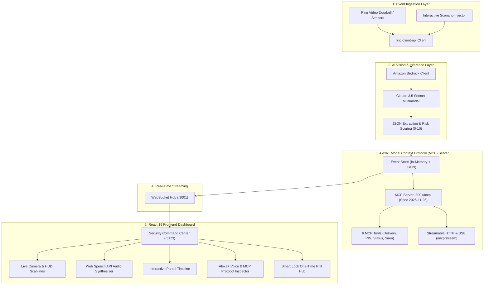

# 🏠 FrontDoor Concierge
### AI-Powered Smart Doorbell Guardian & Alexa+ Model Context Protocol (MCP) Agent

[](https://developer.amazon.com)
[-00CAFF.svg)](https://developer.amazon.com)
[](https://aws.amazon.com/bedrock/)
[](FRICTION_LOG.md)
[](LICENSE)

**FrontDoor Concierge** transforms smart doorbells from passive notification buzzers into an intelligent front-porch concierge and security guardian. Built with **Amazon Bedrock (Claude 3.5 Sonnet Multimodal Vision)**, **Ring's Developer Ecosystem** via `ring-client-api`, and a **Self-Hosted Model Context Protocol (MCP) Server (Spec 2025-11-25 / Streamable HTTP)** for **Alexa+**, it continuously perceives visitors, identifies delivery couriers, computes real-time porch piracy risk scores, generates 1-time courier smart lock PINs, and powers conversational Alexa+ voice agent workflows.

---

## 🌟 Hackathon Tracks & Multi-Category Eligibility

| Hackathon Track / Prize | Implementation Details & Qualification |
| :--- | :--- |
| **Ring Track** *(Primary Track)* | Direct integration with Ring doorbells using `ring-client-api`. Ingests doorbell presses, motion events, person detections, and live camera snapshot frames with a zero-setup fallback simulator for judges. |
| **Alexa+ Track** *(Primary Track)* | Built a **Self-Hosted Model Context Protocol (MCP) Server** (conforming to spec 2025-11-25, Streamable HTTP & JSON-RPC 2.0). Exposes 6 actionable tools and resources to Alexa+ agents, complete with an in-dashboard interactive Alexa+ voice simulator. |
| **AWS Builder Mini-Challenge** | Full integration with **Amazon Bedrock Runtime SDK** (`@aws-sdk/client-bedrock-runtime`) utilizing `anthropic.claude-3-5-sonnet-20241022-v2:0` with vision capabilities for zero-shot carrier detection, package dimension estimation, visitor intent classification, and porch piracy risk scoring. |
| **Open Source Mini-Challenge** | Distributed under the permissive **MIT License** with modular repository architecture, comprehensive documentation, and sample datasets. |
| **Friction Log Bonus (+10%)** | Comprehensive [FRICTION_LOG.md](FRICTION_LOG.md) covering Headless Ring 2FA OAuth, MCP Streamable HTTP protocols, and AWS Bedrock multimodal payload serialization. |

---

## 🏗️ Architecture & Pipeline



---

## 🛠️ Registered Model Context Protocol (MCP) Tools

The self-hosted MCP server exposes 6 high-utility tools to Alexa+ and agentic skills via `POST /mcp` (Streamable HTTP):

1. `check_front_door_status`: Inspects live camera state, active threats, and recent porch events.
2. `inspect_latest_delivery`: Queries courier identity (Amazon, UPS, FedEx), package size, delivery timestamp, and Bedrock confidence.
3. `speak_to_visitor`: Delivers an audible instruction through the Ring doorbell two-way speaker.
4. `generate_smart_lock_pin`: Creates a temporary 1-time access PIN (e.g. 15-minute PIN) for trusted couriers or guests to unlock the porch parcel box or gate.
5. `escalate_threat_alert`: Triggers high-risk emergency protocol (90dB siren, emergency mobile push notification, and evidence snapshot).
6. `query_daily_analytics`: Aggregates today's delivery metrics, courier breakdown, and security alerts.

---

## ✨ Key Features

1. **Autonomous Courier Identification**:
   - Classifies uniforms and packages across **Amazon Logistics**, **UPS**, **FedEx**, **USPS**, and **DHL** with confidence metrics.
2. **Porch Piracy & Threat Scoring (0–10)**:
   - Assesses dwell time, body posture, face concealment, and package tampering to compute an actionable risk score.
   - Triggers dynamic red alert pulses, sirens, and audio warnings if risk exceeds safety thresholds.
3. **Conversational Alexa+ Voice & MCP Simulator**:
   - Web-based conversational agent simulator with speech-to-text / text-to-speech.
   - Interactive **Live MCP JSON-RPC 2.0 Payload Inspector** showing the exact request and response envelopes in real time.
4. **Smart Lock & Access Control Hub**:
   - Generates temporary, time-decaying 4-digit PINs for delivery couriers to unlock porch delivery boxes.
5. **Resilient Dual-Mode Operation**:
   - **Production Mode**: Connects directly to authenticated Ring accounts via `RING_REFRESH_TOKEN` to monitor actual hardware doorbells and camera snapshots.
   - **Simulator Mode**: Fully operational standalone experience for judges, equipped with 5 pre-configured scenarios (*Doorbell Delivery*, *Motion Alert*, *Package Dropped*, *Visitor Arrived*, *Suspicious Threat*).

---

## 🚀 Quick Start Guide

### Prerequisites
- **Node.js**: v18.0.0 or later
- **npm**: v9.0.0 or later
- *(Optional)* AWS Credentials with access to Bedrock (`us-east-1` recommended)
- *(Optional)* Ring Account Refresh Token

### 1. Installation
Clone the repository and install all dependencies:
```bash
# From frontdoor-concierge root
npm install
cd server && npm install
cd ../client && npm install
cd ..
```

### 2. Configuration (.env)
Copy the example environment configuration in the project root:
```bash
cp .env.example .env
```
Configure your credentials in `.env`:
```env
# AWS Configuration (Optional: mock engine activates automatically if omitted)
AWS_REGION=us-east-1
AWS_ACCESS_KEY_ID=your_access_key
AWS_SECRET_ACCESS_KEY=your_secret_key
BEDROCK_MODEL_ID=anthropic.claude-3-5-sonnet-20241022-v2:0

# Ring Credentials (Optional: launches simulator mode if omitted)
RING_REFRESH_TOKEN=your_token

# Server & Client Ports
PORT=3001
CLIENT_URL=http://localhost:5173
```

### 3. Launch the Application
Run both the backend API and frontend Vite dev server concurrently:
```bash
npm run dev
```
- **Frontend Dashboard**: [http://localhost:5173](http://localhost:5173)
- **Backend API & WebSockets**: [http://localhost:3001](http://localhost:3001)
- **MCP Server Endpoint**: [http://localhost:3001/mcp](http://localhost:3001/mcp)
- **MCP SSE Stream**: [http://localhost:3001/mcp/stream](http://localhost:3001/mcp/stream)

---

## 🎮 Hackathon Demo Scenarios

### Mode A: Porch Guardian View
1. **Ring Doorbell (Amazon Delivery)**: Simulates an Amazon Logistics courier ringing the bell. Bedrock detects the uniform, greets the driver, and marks risk as low (1/10).
2. **Threat Detected (Porch Piracy Attempt)**: Flags suspicious loitering and package tampering. Instantly triggers screen shake, high-risk banner (9/10), and emergency dispatch recommendations.

### Mode B: Alexa+ Voice & MCP Console View
1. Click the **🗣️ Alexa+ MCP Agent** tab in the top navigation bar.
2. Click **"Alexa, who is at the front door?"** ➔ Watch Alexa execute the `check_front_door_status` MCP tool and inspect the JSON-RPC 2.0 payload!
3. Click **"Alexa, generate a PIN for the UPS driver"** ➔ Watch Alexa generate a temporary 4-digit smart lock PIN valid for 15 minutes.
4. Switch to the **🔐 Smart Lock** tab to see active codes and validity countdowns.
5. Switch to the **⚡ MCP Tools** tab to inspect all 6 registered tool JSON schemas.

### Mode C: Panoramic Split View
Click **🔀 Split View** to view the live camera HUD, parcel timeline, and Alexa+ MCP voice console side-by-side.

---

## 📄 Friction Log & License

- **Friction Log**: [FRICTION_LOG.md](FRICTION_LOG.md) (+10% judging bonus documented)
- **License**: [MIT License](LICENSE) (Open Source mini-challenge qualified)
